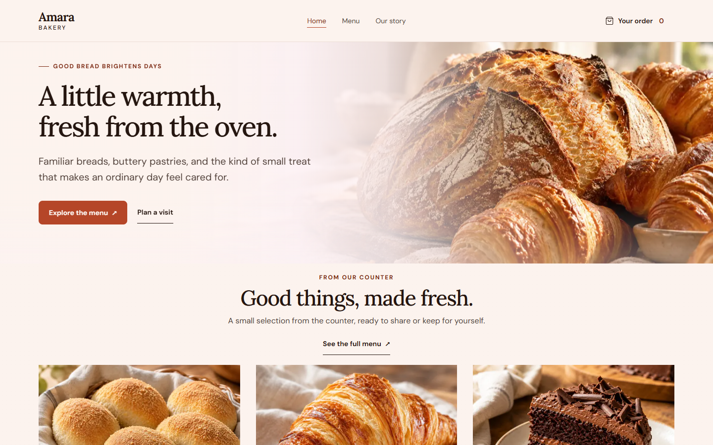

# Amara Bakery

A fictional bakery storefront built as a frontend portfolio project. Browse twelve products, choose quantities, save an order locally, and complete a demo checkout. The design pairs warm cream, espresso, and terracotta with editorial photography and a restrained serif voice.



## Design and engineering decisions

- **A coherent bakery identity.** Lora headings, DM Sans body text, a shared token system, and food photography carry the warm visual direction across all three routes. The desktop hero gives the text a calm cream backdrop; mobile uses a separate photo below the copy.
- **Useful interaction before decoration.** Category filters, quantity limits, live totals, remove/Undo, and completion states demonstrate a complete shopping flow. Checkout is explicitly a simulation.
- **Motion with a choice.** The default follows the system preference. Visitors can enable or reduce motion and return to the system setting. Desktop storytelling uses GSAP ScrollTrigger image transitions; mobile uses light scroll reveals. Native scrolling is preserved.
- **Accessible components.** Radix handles dialog focus trapping and Escape behavior. Controls have visible focus, descriptive labels, sensible touch targets, and live feedback where it helps. Reduced motion retains all content and functionality.
- **Predictable state.** Order and motion stores use `useSyncExternalStore` with stable server snapshots. Saved order data is validated before use, invalid products are discarded, and unavailable storage falls back to the current session.
- **Responsive image delivery.** Next.js Image supplies optimized variants with layout-aware sizes. The original generated PNGs remain available as source assets; performance is measured against delivered resources rather than source file sizes. Local fonts are preloaded with matched fallback metrics through `next/font`, and the desktop story animation libraries load only when needed.

## Run locally

Use Node.js 20.9 or later and npm, then run from this folder:

```sh
npm install
npm run dev -- --hostname 127.0.0.1 --port 3100
```

Open [Amara locally](http://127.0.0.1:3100). The storefront is a frontend demo: product data and cart state are handled in the browser, and checkout does not charge a payment method or submit an order to a bakery.

For a production preview, run `npm run build`, then `npm run start -- --hostname 127.0.0.1 --port 3102` and open [the production preview](http://127.0.0.1:3102).

On this Windows machine, if `npm` resolves to a broken roaming installation, invoke `& 'C:/Program Files/nodejs/npm.cmd'` in PowerShell in place of `npm`.

## Stack and structure

Next.js 16 App Router, React 19, TypeScript, Tailwind CSS 4, GSAP ScrollTrigger, Radix Dialog, and Lucide. Lora and DM Sans variable fonts are served locally.

| Location | Responsibility |
| --- | --- |
| `src/app` | Home, menu, order, not-found page, metadata, and shared styles |
| `src/components` | Navigation, product dialogs, cards, story, and order views |
| `src/context` | Persistent order state and motion preferences |
| `src/data` / `src/lib` | Catalog data, validated order operations, and currency formatting |
| `tokens.css` | Color, typography, spacing, and motion tokens |
| `tests` | Browser interaction, accessibility, and responsive checks |
| `scripts` / `docs` | Share-card generation, performance checks, and review artifacts |

## Demo behavior

- Browse and filter the 12 sample products.
- Add products, change quantities, and revisit the cart after refreshing the page.
- Remove a cart item and use Undo to restore it.
- Complete a sample order to see the confirmation state. Starting a new order clears the previous cart.
- Follow the four stages of the Baking Story on desktop, or read them all together on mobile and with reduced motion.
- Motion preferences apply across the site, survive refreshes, and can be reset to follow the system.

## Tests

Run `npm run lint`, `npm run typecheck`, and `npm run test` for lint, strict typing, and the four order-helper tests. Run the end-to-end suite with:

```sh
npm run test:e2e
```

The Playwright suite covers shopping, keyboard behavior, motion preferences and persistence, scroll-driven storytelling, mobile navigation, accessibility, and responsive layouts. It starts the local app on port 3100 and saves review screenshots in `docs/screenshots/`. The performance and browser validation report lives in `docs/quality-report.md`.

The suite uses locally installed Microsoft Edge. To target an already-running production server in PowerShell: `$env:AMARA_TEST_URL='http://127.0.0.1:3102'; npm run test:e2e`. Clear that variable afterward with `Remove-Item Env:AMARA_TEST_URL`.

## Sharing and deployment preparation

The app includes an Open Graph share card, Twitter large-card metadata, and an Amara favicon. Regenerate the card with `npm run generate:share` after changing its photography or copy. This uses the same local fonts and hero image as the storefront.

Before deployment, set `AMARA_SITE_URL` to the actual public origin so shared image URLs resolve to the deployed site. `.env.example` documents the setting; the local fallback is `http://localhost:3102`. On Vercel, the production project URL is used when available. No public domain has been invented for this preview.

## Scope and tradeoffs

This is a client-side portfolio demo, with no backend, accounts, payment collection, or real fulfillment. Orders belong to the current browser and are not synchronized across devices. Product names, prices, address, and opening hours are fictional. Image credits are included below.

Browser tests use emulated viewport sizes; they do not substitute for testing on a physical phone. Local performance measurements also differ from a deployed site with network latency and CDN caching. Those limits are recorded with the results rather than presented as real-user metrics.

## Credits

Product and Baking Story photographs are original synthetic images generated for this fictional demo with OpenAI image generation; no real bakery or products are depicted. The Baking Story progress path is custom inline SVG artwork. The bundled Lora and DM Sans fonts are distributed under the SIL Open Font License. GSAP is licensed under the standard no-charge GreenSock license for this demo; Lucide icons are ISC licensed, and Radix UI Dialog is MIT licensed.

Photo prompts and provenance are recorded in `public/images/credits.json`. Names, sample prices, location, and opening hours are fictional. Orders stay in this browser, including demo completion; disabled browser storage falls back to an in-memory order for the current visit.
